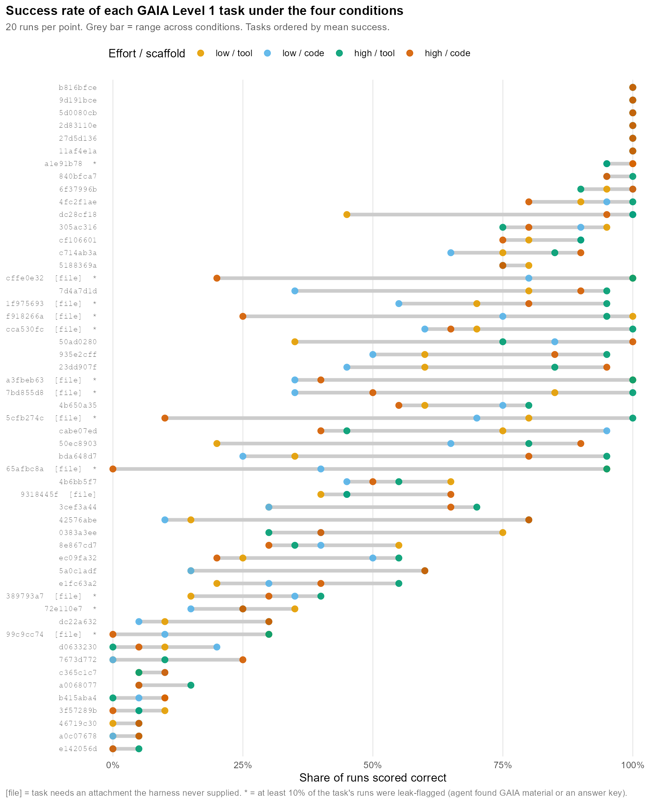
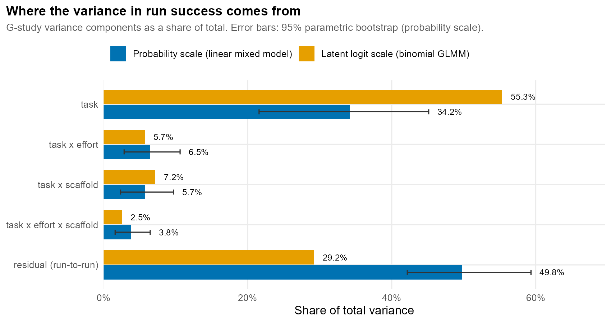
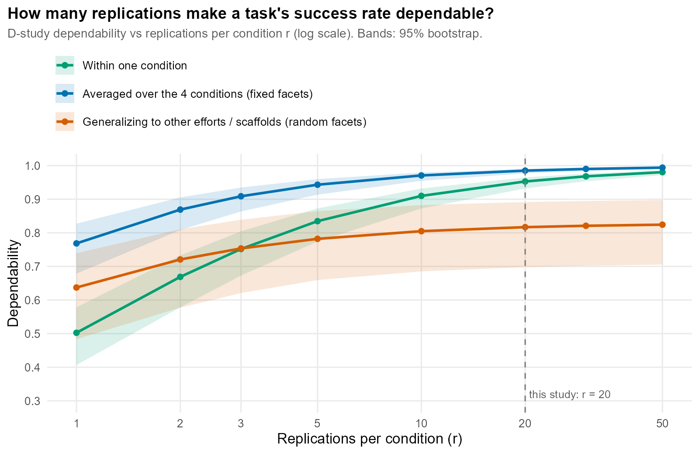
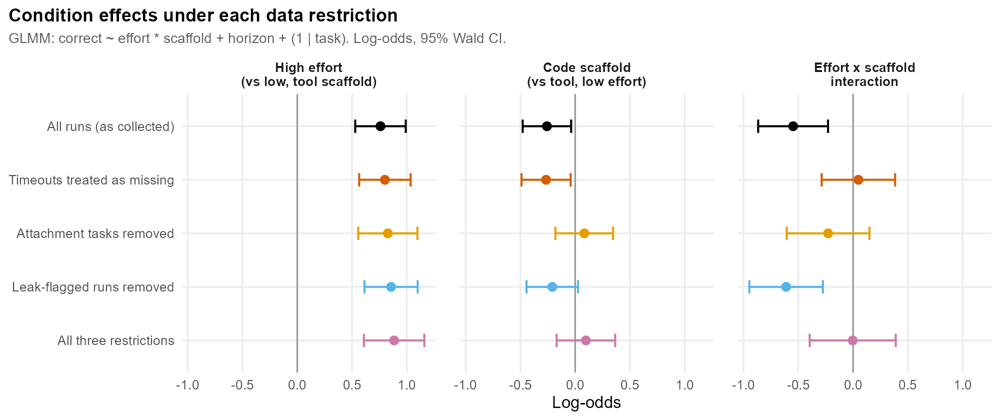
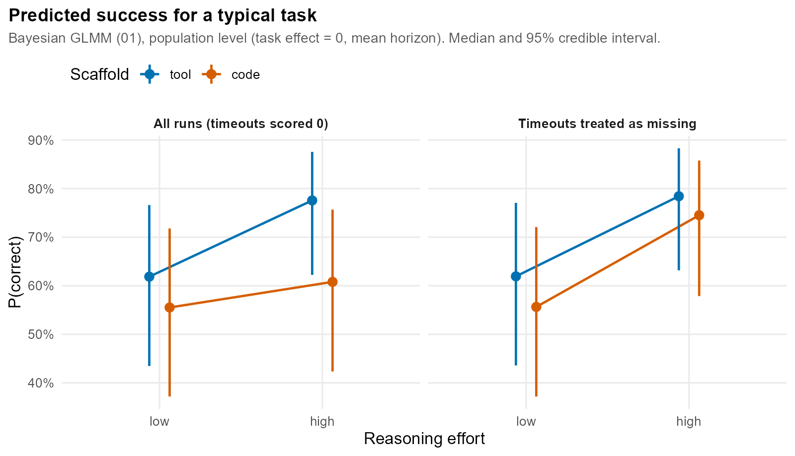
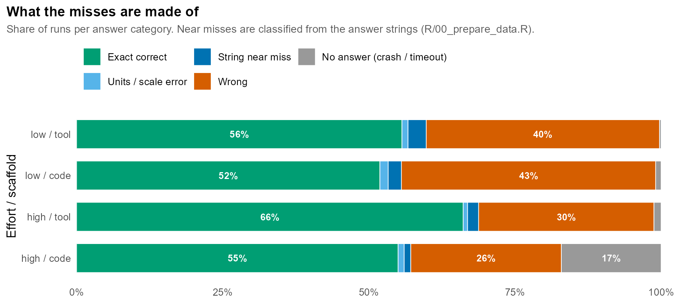
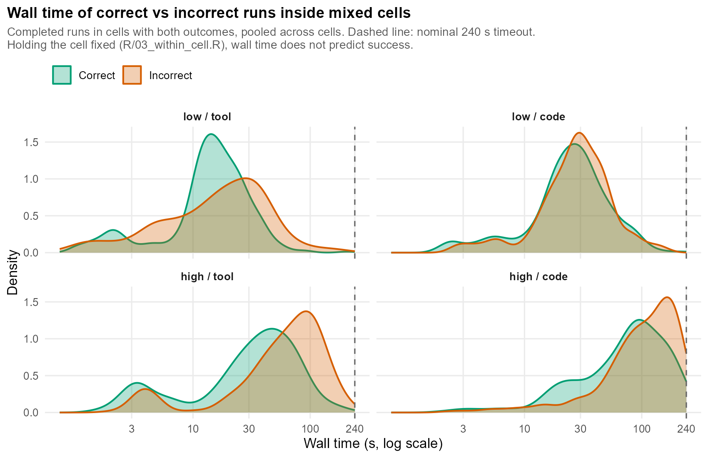
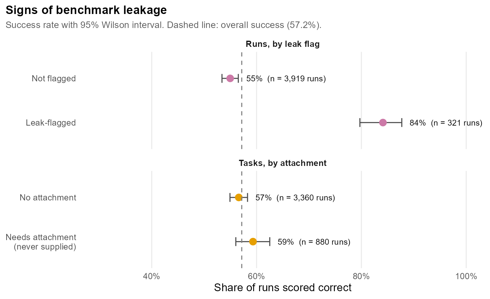

# How Much of an AI Agent's Success Is Noise? A Generalizability-Theory Study on GAIA

*By Thomas Szymanski*

An AI agent was run **4,240 times** on the 53 GAIA Level 1 validation tasks: every task under every combination of two reasoning-effort levels and two agent scaffolds, with 20 independent replications each. **Generalizability Theory (G-theory)** then splits the variance in success into stable task difficulty, task × condition interactions, and pure run-to-run randomness.

**Main findings (details and caveats below):**

- **About half of the variance in whether a run succeeds is run-to-run noise.** On the probability scale, 49.8% (95% CI 42–59%) is residual variance within a fixed task and condition. Stable task difficulty accounts for 34.2% (22–45%).
- **A single run is a poor measurement of a task.** Its dependability is 0.50 within one condition. About 5 replications per condition bring it to 0.84, and 20 bring it to 0.95.
- **The conditions shift accuracy more than they reorder tasks.** The three task × facet interactions together explain 16% of the variance.
- **High reasoning effort reliably helps**, by +0.76 log-odds (about +10 percentage points), in every sensitivity analysis. The apparent effects of the scaffold and its interaction with effort did not survive the sensitivity checks: they came from a harness timeout bug and from tasks whose attached files were never given to the agent.
- **There is clear evidence of benchmark leakage.** In 321 runs the agent found GAIA material or published answer keys online, and those runs succeed 84% of the time against 55% for the rest. Tasks whose attachment was never supplied are still solved 59% of the time.

---

## Contents

1. [Background and research question](#1-background-and-research-question)
2. [Study design](#2-study-design)
3. [Methods](#3-methods)
4. [Findings](#4-findings)
5. [Sensitivity analyses](#5-sensitivity-analyses)
6. [Limitations](#6-limitations)
7. [Reproducing the analysis](#7-reproducing-the-analysis)
8. [Repository layout and data dictionary](#8-repository-layout-and-data-dictionary)

---

## 1. Background and research question

Applications of psychometric modeling frameworks in the study of Large Language Models (LLMs) are at a crossroads. On the one hand, the demand for the rigor that these frameworks have historically supplied is substantial. Various benchmarks and evaluations that have been applied to LLMs lack theoretical foundation, are vulnerable to data contamination, and fail to provide valid, reproducible results. This problem is compounded by the fact that the rapid advance of LLMs has rendered many evaluations obsolete, since top-tier models approach performance ceilings that make meaningful differentiation implausible. Nonetheless, many of these benchmarks continue to be propagated, contributing to community disenchantment with "benchmaxxing", i.e. selective model optimization for leaderboards that fail to reflect models' actual capabilities.

On the other hand, both systematic issues and continuing research gaps have prevented psychometric modeling methods from providing a holistic substitute for flawed benchmarking practices. LLMs frequently violate the core assumption of psychometrics that traits are consistent across contexts. Both prompt sensitivity and the stochasticity introduced during text generation impact reproducibility in any context. Moreover, alignment training heavily influences LLM performance on many traditional psychometric instruments, such as personality tests. This calls into question whether LLMs possess internal latent traits or just simulate them based on context. Similarly, there remains substantial research to be done in the area of the side effects of alignment - e.g., whether training models to be empathetic directly leads to sycophantic behavior - and construct validity. Finally, the lack of standardized item-level data releases limits researchers' capacity to rigorously validate evaluation metrics. Without these data, many traditional psychometric modeling methods such as Item Response Theory (IRT) cannot be applied.

Researchers must act to address these issues, especially considering the advent of agentic systems and programming. This development bears investigation as agentic system failure types and behavioral issues have the potential to cause substantial harm, with ramifications for resource management, organizational and individual security, and other areas. Importantly, agentic evaluation is especially challenging because agentic failure is structurally multi-sourced. When approaching longer-horizon tasks, agentic systems may fail due to compounding errors, context degradation, poor state management, or other issues. Existing research has provided taxonomies of agentic failure types, but psychometric modeling offers the possibility of disentangling variance relating to multi-causal failures.

The contribution of this study is therefore to address a methodological gap in psychometric modeling for LLM evaluation, specifically its application to agentic systems. While researchers have increasingly explored adaptations of traditional psychometric frameworks such as IRT and Classical Test Theory (CTT), no such exploration exists for G-theory (Generalizability Theory). G-theory is a CTT-derived framework that is used to evaluate the reproducibility of measurements under specific conditions. At its core, the framework partitions the total variance in a set of measurements into separate components: one attributable to the object of measurement and others attributable to distinct, potentially interacting sources of variation termed facets. Estimating the relative magnitude of these components reveals how much each facet, rather than the object of measurement itself, contributes to the variability of observed scores. This study proposes importing the G-theory framework into the evaluation of agentic systems.

In a critical step forward for understanding agentic system failures, G-theory allows for the estimation of variance components, enabling researchers to establish which facets of an agentic system explain the most variance across measurements. Moreover, G-theory's distinctive strength for the purposes of this field is that stochastic model variance itself is measured as a residual/replication component. G-theory consequently lets us quantify how much of the total variance is attributable to generation stochasticity, relative to the chosen facets. Another highly relevant strength of G-theory is that it does not commit to a latent-trait model like IRT. This means that the aforementioned concerns about the presence or suspected simulation of latent traits have no bearing on G-theory's findings.

**Research questions.** Concretely, the analysis asks:

1. **Variance partition.** How much of the variance in a run's success is stable task difficulty, how much comes from tasks reacting differently to effort and scaffold, and how much is run-to-run noise?
2. **Measurement design (D-study).** How many replications are needed before a task's success rate is a dependable measurement?
3. **Facet effects.** Do reasoning effort and the manager scaffold change success, and do they reorder which tasks are hard?
4. **Failure anatomy.** When the agent fails, is it slightly wrong (units, formatting) or entirely wrong? Is it wrong the same way each time? Can its process data (steps, tool calls, time) predict which replications fail?

## 2. Study design

In this study, we execute a crossed 2×2 design with reasoning levels and agentic scaffolding (architecture) as facets. The agentic harness chosen is Hugging Face's smolagents. This open-source Python library allows for LLM integration using LiteLLM and leverages a lightweight two-tier agentic system: a top-level manager agent that coordinates a managed web-search agent. The scaffolding facet swaps the manager between a CodeAgent (code-as-action) and a ToolCallingAgent (JSON tool-calling), while the web-search agent is held constant across both conditions. The study uses gpt-5.4-mini as the model of choice, given its stated utility for agentic tasks. The reasoning facet has two levels: low and high.

The objects of measurement are the 53 GAIA level one tasks, an established pool of web-domain exercises against which models are tested. These foundational tasks involve basic tool usage and require relatively few sequential steps to complete (a median of 5 annotator steps, range 1–15). Nonetheless, they provide grounds for testing core model capacities such as text and data retrieval and multi-step reasoning over web sources. (GAIA also contains file-handling and multimodal tasks, but the harness used here never passes attached files to the agent; see [Limitations](#6-limitations).) Moreover, the GAIA tasks are well-suited for gathering item-level responses intended for dichotomous psychometric modeling, since they demand unambiguous answers and award no partial credit. That is to say, each task completion yields a binary signal pertaining to success or failure. Comparing the model answer with the established correct answer also yields signals pertaining to particular error types, such as unit mismanagement or hallucinated figures. The GAIA tasks also contain metadata on horizon length and tool calls from logs of task completion by humans. This allows us to supplement the process data collected over the course of running the agentic system on these tasks. The data generating process was orchestrated from a single Windows desktop, with all model inference performed through the OpenAI API.

| Design element | Levels | Role in the G-study |
|---|---|---|
| Task (object of measurement) | 53 GAIA Level 1 validation tasks | random |
| Reasoning effort | `low`, `high` (`reasoning_effort` parameter) | fixed facet |
| Manager scaffold | `tool` (ToolCallingAgent), `code` (CodeAgent) | fixed facet |
| Replication | 20 independent runs per cell, fresh agent each time | residual (nested in cells) |
| Held constant | model `gpt-5.4-mini`, temperature 1, Serper web search, 240 s timeout, manager ≤ 8 steps, web agent ≤ 10 steps | — |

Total: 53 × 2 × 2 × 20 = **4,240 runs**, collected 27–30 June 2026. Temperature was originally intended as a second facet, but gpt-5.x reasoning models reject any temperature other than 1 when `reasoning_effort` is set, so the scaffold took its place.

## 3. Methods

### 3.1 Harness and scoring

[`harness/gaia_gt_pilot.py`](harness/gaia_gt_pilot.py) builds a fresh two-tier smolagents agent for every run, so replications share no memory.

- The **web agent** is a ToolCallingAgent with a Serper search tool and a page-visit tool. For Wikipedia URLs the visit tool uses the MediaWiki extracts API, because the raw HTML buries the content beneath navigation markup. Pages are truncated to 8,000 characters.
- The **manager** is the scaffold facet: a ToolCallingAgent or a CodeAgent. It delegates to the web agent and must finish with `FINAL ANSWER: …`.
- **Scoring** uses the official GAIA scorer: exact match after number, list and string normalization.
- **Logging:** each run records its outcome, answer, wall time, the manager's typed trajectory (steps, tool calls, errors) and error flags. [`harness/aggregate_to_csv.py`](harness/aggregate_to_csv.py) flattens these into one row per run.

### 3.2 Analyses

All modelling and plotting is in R ([`R/`](R/)). The scripts are numbered in execution order.

| Script | Question | Method |
|---|---|---|
| [`00_prepare_data.R`](R/00_prepare_data.R) | — | Classifies answers into error categories, salts and hashes answers, removes all GAIA text → `data/gaia_runs_public.csv` |
| [`01_bayes_glmm.R`](R/01_bayes_glmm.R) | Facet effects, task heterogeneity | Bayesian logistic GLMMs (brms/cmdstanr): task intercepts, task-specific facet slopes, task-type model; LOO comparison; latent ICC; timeout sensitivity fit |
| [`02_cell_models.R`](R/02_cell_models.R) | Consistency at the cell level | Cumulative-link mixed model of the consistency tier (never/mixed/always); beta-binomial GLMM of cell success counts; both with task random intercepts |
| [`03_within_cell.R`](R/03_within_cell.R) | Does process predict *which* replications succeed? | Binomial GLMM with within-cell-centred predictors; LRTs; within-cell concordance, in-sample and 10-fold cross-validated |
| [`04_answer_nearmiss.R`](R/04_answer_nearmiss.R) | How wrong are the misses? | Rule-based answer categories; lenient-credit accuracy |
| [`05_answer_dispersion.R`](R/05_answer_dispersion.R) | Wrong the same way, or scattered? | Per-cell answer entropy and modal-answer frequency |
| [`06_gstudy.R`](R/06_gstudy.R) | Variance partition, required replications | G-study (linear mixed model, 500-draw parametric bootstrap) + latent-scale GLMM; D-study for three universes of generalization |
| [`07_sensitivity.R`](R/07_sensitivity.R) | Robustness to data artifacts | Re-estimates effects and the G-study without timeouts, attachment tasks or leak-flagged runs |
| [`08_figures.R`](R/08_figures.R) | — | All figures (ggplot2, Okabe-Ito palette via {see}) |

**The G-study model.** Tasks *p* are crossed with effort *e* and scaffold *s*, and replications *r* are nested within cells. The model is

```
correct ~ effort * scaffold + (1 | task) + (1 | task:effort) + (1 | task:scaffold) + (1 | task:effort:scaffold)
```

The facet main effects are fixed. The variances of the random terms, together with the residual, are the G-study components. The main estimate is a linear mixed model on the 0/1 outcome, which gives components on the probability scale. This is the classic ANOVA-style G-study, and treating a binary outcome as linear is a known approximation. A binomial GLMM with the residual fixed at π²/3 serves as a latent-scale cross-check.

**The D-study** reports dependability, τ / (τ + error), as a function of *r*, the number of replications per condition, for three universes:

| Universe | Universe-score variance τ | Error variance |
|---|---|---|
| Within one condition | σ²ₚ + σ²ₚₑ + σ²ₚₛ + σ²ₚₑₛ | σ²ᵣₑₛ / r |
| Averaged over the 4 conditions (fixed facets) | σ²ₚ + σ²ₚₑ/2 + σ²ₚₛ/2 + σ²ₚₑₛ/4 | σ²ᵣₑₛ / 4r |
| Generalizing to other effort levels/scaffolds (random facets) | σ²ₚ | σ²ₚₑ/2 + σ²ₚₛ/2 + σ²ₚₑₛ/4 + σ²ᵣₑₛ / 4r |

Because every replication is nested in a cell, relative and absolute error coincide.

## 4. Findings

### 4.1 Success varies widely within tasks


*Figure 1. Each row is a task and each point is one condition's success rate over 20 runs. Only 6 tasks are solved every time under every condition. Many tasks span more than 50 percentage points across conditions, and even inside a single condition most success rates lie strictly between 0% and 100%.*

Overall exact-match success was **57.2%**. By condition (effort / scaffold) it was 55.7% for low/tool, 51.9% for low/code, **66.1% for high/tool**, and 55.0% for high/code.

Of the 212 design cells:

- **158 (75%) are "mixed".** The same task under the same settings succeeds on some replications and fails on others.
- **41 are always correct.**
- **13 are never correct.**

Answer dispersion ([`05`](R/05_answer_dispersion.R)) shows what kind of failure dominates. In 12 of the 13 never-correct cells the agent gives *different* wrong answers across runs: on average 6.3 distinct answers per cell, with normalized entropy 0.54. Only one cell repeats the same wrong answer. Consistent failure on these tasks is therefore mostly unstable failure rather than a systematic misconception.

### 4.2 About half the variance is run-to-run noise


*Figure 3. Variance components as a share of total variance, on the probability scale (linear mixed model, 95% bootstrap intervals) and the latent logit scale (binomial GLMM).*

| Component | Probability scale (95% CI) | Latent logit scale |
|---|---|---|
| Task (stable difficulty) | **34.2%** (21.6–45.1) | 55.3% |
| Task × effort | 6.5% (2.8–10.6) | 5.7% |
| Task × scaffold | 5.7% (2.4–9.7) | 7.2% |
| Task × effort × scaffold | 3.8% (1.6–6.5) | 2.5% |
| Residual (run-to-run) | **49.8%** (42.2–59.3) | 29.2% |

On the probability scale, which is the scale success rates are reported on, **run-to-run noise is the largest source of variance**. Fixing the task, the effort level and the scaffold still leaves an outcome that is roughly as unpredictable as everything else combined. On the latent scale, task difficulty is the larger share. This is partly a property of that scale: a logistic model's residual is fixed at π²/3, and the between-task spread is stretched for tasks near 0% or 100%. Both views agree on two points. Run-level stochasticity is a first-order source of variance, not a nuisance term. And the three task × facet interactions are small (12–16% combined), so **changing effort or scaffold moves the overall level of success far more than it reshuffles which tasks are hard**.

The Bayesian GLMMs ([`01`](R/01_bayes_glmm.R)) give a complementary view of the same data. A model that lets the effort and scaffold effects vary by task fits clearly better than a task-intercept-only model (ΔELPD = 172 ± 18). The heterogeneity is therefore real even though it is small relative to the residual. The coarse task-type tag adds nothing beyond task identity (ΔELPD = −0.2 vs the base model; every task-type coefficient's interval spans zero). The latent ICC of the single-intercept model is 0.65 (95% CrI 0.55–0.75), higher than the G-study's 0.55 because a single intercept absorbs the task × facet interactions that the G-study separates out.

### 4.3 A single run is not a dependable measurement


*Figure 4. D-study dependability by replications per condition, with 95% bootstrap bands.*

| Universe | r = 1 | r = 5 | r = 20 |
|---|---|---|---|
| Within one condition | 0.50 (0.41–0.58) | 0.84 (0.77–0.87) | 0.95 (0.93–0.97) |
| Averaged over the 4 conditions (fixed facets) | 0.77 (0.68–0.83) | 0.94 (0.91–0.96) | 0.99 (0.98–0.99) |
| Generalizing to other effort levels/scaffolds (random facets) | 0.64 (0.48–0.74) | 0.78 (0.66–0.87) | 0.82 (0.70–0.89) |

The design's 20 replications are more than enough to fix a task's success rate *within* a configuration. About five replications per condition already reach 0.84. Single-run benchmark numbers, the norm on leaderboards, have a dependability of about 0.5 at the task level.

The random-facet curve levels off near 0.82. If the goal is a task score that holds for effort levels or scaffolds *not tested here*, adding replications stops helping, because the task × facet interactions become the binding source of error. Only sampling more configurations would raise it.

### 4.4 Effort helps; the scaffold effect does not survive scrutiny


*Figure 5. Effort and scaffold effects (log-odds, 95% CI) from the same GLMM fitted to five subsets of the data. Black: all runs as collected.*

On the data as collected, three effects look credible:

- high effort helps (+0.76 log-odds)
- the code scaffold hurts (−0.26)
- the effort × scaffold interaction is negative (−0.55, p = .001), meaning high effort helps much less under the code scaffold

**Only the effort effect is robust:**

- **The interaction disappears (+0.05, p = .78) once timeouts are treated as missing.** In this run the harness's 240 s timeout did not stop the agent. 163 of the 177 timeouts fell in the high/code cell and were scored as failures (Figure 2). With the timeouts removed, high/code success rises from 55.0% to 65.0%, essentially level with high/tool (67.0%).
- **The code-scaffold penalty disappears (+0.08, p = .54) once the 11 attachment tasks are dropped.** Those tasks are unsolvable as designed, and the two scaffolds evidently guess or retrieve answers to them at different rates.
- **High effort is positive and significant in every subset** (+0.76 to +0.88 log-odds).


*Figure 6. Predicted success for a typical task (task effect = 0, mean horizon) from the Bayesian base model, with timeouts scored as failures (left) and treated as missing (right). Median and 95% credible interval.*

The Bayesian base model ([`01`](R/01_bayes_glmm.R); 4 chains × 4,000 post-warmup draws, R-hat ≤ 1.01, bulk ESS ≥ 720, no divergences) tells the same story on the probability scale:

- **Timeouts scored as failures:** high effort raises a typical task's success from 62% to 78% with the tool scaffold, but only from 56% to 61% with the code scaffold. The interaction is −0.55 (95% CrI −0.87 to −0.22).
- **Timeouts treated as missing:** high/code rises to 75% (58–86%), level with high/tool at 78%. The interaction is +0.05 (−0.28 to 0.38).

The cell-level models in [`02`](R/02_cell_models.R) agree. A beta-binomial GLMM of the cell success counts finds a high-effort effect of +0.66 (p = .003), a non-significant scaffold effect (−0.23, p = .30) and a non-significant interaction (−0.46, p = .13). Neither facet significantly shifts a cell's consistency tier (LRT χ²(2) = 4.4, p = .11).

### 4.5 What the misses are made of


*Figure 2. Runs by answer category in each condition. "No answer" is almost entirely the high/code timeout artifact.*

| Category | Share of runs |
|---|---|
| Exact correct | 57.2% |
| Units / scale error (e.g. answering in units when thousands were asked for) | 1.1% |
| String near miss (e.g. an abbreviation, a plural, a list with one extra element) | 2.1% |
| Wrong | 34.8% |
| No answer (crash, timeout, empty) | 4.9% |

Giving credit for units/scale errors and string near misses would lift accuracy only from **57.2% to 60.3%**. Most misses are genuinely wrong answers, not formatting slips. An earlier version of the classifier reported 1.3% "numeric near misses". Each of them turned out to be a different integer (e.g. a count off by a few percent), which is simply wrong, and the rule now requires at least one non-integer value. A stratified sample of every category is written to a private audit sheet for manual review.

### 4.6 Process data does not predict which replications fail


*Figure 7. Wall time of correct and incorrect completed runs in mixed cells, pooled across cells.*

Pooled across cells, failing runs look slower, particularly with the tool scaffold (Figure 7). Most of that difference lies *between* cells, though: hard task-configurations are both slow and failure-prone. Within a single cell [`03`](R/03_within_cell.R) finds no signal:

| Within-cell test (2,973 completed runs in 156 mixed cells) | Result |
|---|---|
| LRT: manager steps + tool calls | χ²(2) = 4.5, p = .11 |
| LRT: + log wall time | χ²(1) = 0.08, p = .78 |
| Within-cell concordance, in-sample / 10-fold CV | 0.54 / 0.49 (0.5 = chance) |
| Previous "AUC", including cell intercepts | 0.86 |

The previously reported AUC of 0.86 measured how much cells differ in base rate, not anything the process metrics add. **Given the task and configuration, which replication succeeds looks like a draw.** This is the micro-level counterpart of the large residual component in 4.2.

## 5. Sensitivity analyses

Three problems with the collected data are described in [Limitations](#6-limitations). [`07_sensitivity.R`](R/07_sensitivity.R) re-estimates the main quantities with each problem removed:

| Subset | Runs | Tasks | Success | Task | Task × facets | Residual | Dep. (r = 1) | Dep. (r = 20) |
|---|---|---|---|---|---|---|---|---|
| All runs (as collected) | 4,240 | 53 | 57.2% | 34.2% | 16.0% | 49.8% | 0.50 | 0.95 |
| Timeouts treated as missing | 4,063 | 53 | 59.7% | 35.9% | 13.8% | 50.3% | 0.50 | 0.95 |
| Attachment tasks removed | 3,360 | 42 | 56.6% | 44.0% | 9.7% | 46.4% | 0.54 | 0.96 |
| Leak-flagged runs removed | 3,919 | 53 | 55.0% | 33.1% | 19.6% | 47.3% | 0.53 | 0.96 |
| All three restrictions | 3,190 | 42 | 57.5% | 43.9% | 10.6% | 45.4% | 0.55 | 0.96 |

*Task, Task × facets and Residual are shares of total variance. Dependability (Dep.) is within one condition.*

The G-study's central result holds in every subset: **run-to-run noise accounts for 45–50% of the variance, and a single run has a dependability of about 0.5**. Removing the attachment tasks raises the stable task share (34% → 44%) and shrinks the task × facet interactions (16% → 10%). This fits those tasks being solved erratically by guessing or answer retrieval rather than by capability. The facet effects were covered in 4.4. Dropping leak-flagged runs conditions on a post-treatment variable that correlates with success, so that row is a bound, not an estimate.

## 6. Limitations

**Benchmark contamination and leakage.** This is the most serious threat to validity. The GAIA validation answers are public, and the agent sometimes finds them through ordinary web search. One trajectory, for example, cites a blog post that names the GAIA task and its "benchmarked correct output". Runs are flagged when the manager-visible trajectory mentions GAIA or an answer key ("expected answer", "reference solution", …):

- **321 runs (7.6%) on 21 of the 53 tasks are flagged**, and they succeed **84%** of the time against 55% for unflagged runs (Figure 8).
- **The flag is a lower bound.** The managed web agent's own browsing is only visible through its summaries to the manager, and the model may also have memorized answers during pre-training.
- **Attachment tasks are a second, independent signal.** On the 11 tasks whose file was never supplied, accuracy is 59%, slightly *above* the 57% on the other tasks. Examples include a chess-position image (74%) and an audio recording asking for page numbers (75%). These tasks cannot be solved as specified, so success on them reflects answer retrieval or memorization.

Leakage inflates success rates. It probably also inflates run-to-run variance, because whether a search happens to surface an answer key is itself random.


*Figure 8. Success rates of leak-flagged versus other runs, and of tasks with versus without a (never-supplied) attachment.*

**Timeout artifact.** The harness's timeout ran the agent in a thread inside a `with ThreadPoolExecutor(...)` block. On exit that block waits for the thread to finish, so the "240 s limit" never abandoned anything. Runs continued for up to 1,072 s, were then recorded as crashes and scored 0, even when the agent eventually answered. 177 runs were affected, 163 of them in high/code, which created a spurious effort × scaffold interaction (4.4).

The bug has been fixed in the harness after the fact: the executor now shuts down without waiting. **The data were not re-collected.** All analyses use the data as collected, and [`07`](R/07_sensitivity.R) reports results with timeouts treated as missing.

**Attachments never supplied.** The harness tells the agent that a file exists but never provides it. Eleven of the 53 tasks are therefore unsolvable as specified. For future runs, `--exclude-attachments` drops them.

**Run order confounded with time.** Runs were executed in nested order: all 80 runs of one task, condition by condition, over three days. Any drift in the web, the search index or the API over that period is confounded with task and condition, and the residual cannot absorb it. Future runs can use `--shuffle`.

**Process metrics cover only the manager.** `n_steps` and `n_tool_calls` count the manager agent's memory. The step count includes the initial task step and the tool-call count includes the `final_answer` call. The web agent's own searches and page visits are not counted.

**Scope.** The study covers one model (gpt-5.4-mini), one search backend, one benchmark level and two levels of each facet. It examines one temperature (fixed at 1) and one prompt. In G-theory terms, any facet not varied here is hidden in the universe definition. With only two levels per facet, the task × facet components are estimated imprecisely (see the bootstrap intervals).

**Statistical approximations.** The probability-scale G-study fits a linear model to a binary outcome. The latent-scale GLMM is reported alongside it because the two scales partition variance differently (4.2). The answer-category rules are heuristics, so check the private audit sheet before relying on the small categories.

## 7. Reproducing the analysis

### From the public data (no GAIA access needed)

Requirements: R ≥ 4.5 with `tidyverse`, `see`, `scales`, `lme4`, `ordinal`, `glmmTMB`, `pROC`, `brms`, `posterior` and `cmdstanr` (with CmdStan installed). Then, from the repo root:

```bash
Rscript R/run_all.R
```

This runs scripts 01–08 on [`data/gaia_runs_public.csv`](data/gaia_runs_public.csv) and writes the tables to `outputs/` and the figures to `figs/`.

- The brms fits in 01 are cached as `.rds` files (git-ignored) and take about 10 minutes on first run. Delete the cache after changing sampler settings, because brms only notices formula and data changes.
- The G-study bootstrap in 06 (500 refits) is also cached; expect several minutes on first run.
- Step 00 is skipped automatically unless the private data are present.

### Re-collecting data (requires GAIA access and API keys)

```bash
py -3.11 -m venv .venv
```

```bash
.venv/Scripts/python -m pip install -r harness/requirements.txt
```

```bash
.venv/Scripts/python harness/fetch_gaia.py
```

`fetch_gaia.py` needs you to accept the GAIA terms on Hugging Face and run `hf auth login` first. It writes `data/private/gaia_level1.json`. Then set `OPENAI_API_KEY` and `SERPER_API_KEY` and launch the design from PowerShell:

```powershell
.\harness\run_overnight.ps1 -Shuffle -ExcludeAttachments
```

The launcher keeps the machine awake, writes timestamped raw output to `raw/` and aggregates it to `data/private/`. Point `PRIVATE_RUNS` in [`R/00_config.R`](R/00_config.R) at the new CSV and run `Rscript R/run_all.R`; step 00 rebuilds the public CSV. The full design makes about 4,240 agent runs of the OpenAI API and the Serper search API and took about 72 hours sequentially.

### Data and GAIA content

GAIA is a gated dataset, and its maintainers ask that questions and answers not be redistributed in plain text, to keep them out of training corpora. This repository therefore publishes **no question text, ground-truth answers, model answers or trajectories**:

- `data/gaia_runs_public.csv` keeps task IDs, design factors, outcomes, process metrics and derived flags.
- Model answers are replaced by a salted hash (`answer_id`) that supports answer-dispersion analysis but cannot be reversed.
- Everything containing GAIA text lives in the git-ignored `data/private/` and `raw/` folders.

## 8. Repository layout and data dictionary

```
harness/                      data collection (Python 3.11)
  gaia_gt_pilot.py              two-tier smolagents agent, official GAIA scorer, run loop
  aggregate_to_csv.py           raw JSONL -> one row per run (+ timeout/attachment/leak flags)
  fetch_gaia.py                 gated Hugging Face download -> data/private/gaia_level1.json
  run_overnight.ps1             Windows launcher for the full crossed design
  requirements.txt
R/                            analysis and figures (R)
  00_config.R                   paths, data loader, sensitivity subsets, theme, palette
  00_prepare_data.R             private CSV -> public CSV (answer categories, hashed answers)
  01_bayes_glmm.R ... 07_sensitivity.R   analyses (Section 3.2)
  08_figures.R                  all figures
  run_all.R                     runs the whole pipeline
data/
  gaia_runs_public.csv          one row per run, no GAIA text (committed)
  private/                      GAIA tasks, full run CSV, hash salt (git-ignored)
outputs/                      CSV result tables per script (model .rds caches git-ignored)
figs/                         README figures
raw/                          raw JSONL, per-task trajectories, console logs (git-ignored)
```

**`data/gaia_runs_public.csv`** has one row per run (4,240 rows):

| Column | Description |
|---|---|
| `task_id` | GAIA task identifier |
| `run_index` | replication 0–19 within the cell |
| `effort`, `scaffold` | design facets (`low`/`high`, `tool`/`code`) |
| `model`, `temperature`, `search_backend` | held constant (`gpt-5.4-mini`, 1, `serper`) |
| `task_type` | coarse keyword-based domain tag |
| `level`, `horizon_steps`, `horizon_tools` | GAIA level and annotator step/tool counts |
| `has_attachment` | 1 if the task references a file (never supplied) |
| `correct` | 1 if scored correct by the official GAIA scorer |
| `answer_category` | `exact_correct`, `units_scale_error`, `numeric_near_miss`, `string_near_miss`, `wrong`, `no_answer` |
| `answer_id` | salted hash of the normalized model answer (`NA` = no answer) |
| `wall_time_s` | end-to-end wall-clock time |
| `n_steps`, `n_tool_calls`, `n_step_errors` | manager-level process metrics (see Limitations) |
| `empty_answer`, `no_tool_use`, `tool_or_exec_error`, `no_final_answer`, `harness_exception` | error flags |
| `crashed`, `timed_out`, `crash_type` | no answer produced; whether the cause was the timeout |
| `leak_flag` | 1 if the trajectory mentions GAIA or an answer key |
| `timestamp_utc` | run start time |

## License

Code is released under the MIT License (see [`LICENSE`](LICENSE)). The GAIA benchmark is © its authors and subject to its own terms. It is not redistributed here.

*Source benchmark: Mialon et al. (2023), "GAIA: a benchmark for General AI Assistants", <https://huggingface.co/datasets/gaia-benchmark/GAIA>.*
